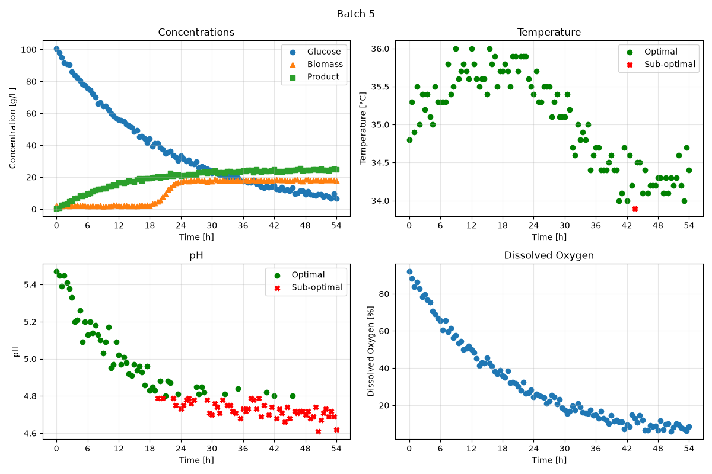

# BioprocessMonitor

Python tool that generates dashboards and summary tables from fermentation batch data.

## Overview

pH and temperature have a big impact on cell growth and productivity in a fermentation, so it's useful to know how long each batch actually stayed within its operating limits.

The goal of this project was to automate that: take a fermentation dataset, split it by batch, check which pH and temperature measurements are within range, and export a dashboard for each batch plus a summary table comparing all of them.

## Features

The `BioprocessMonitor` class in `src/classes.py`:

* loads a fermentation dataset and a set of pH and temperature limits
* extracts the data for a single batch
* checks which pH and temperature measurements are within the acceptable range
* exports a 2 x 2 dashboard for a batch (concentrations, temperature, pH, dissolved oxygen)
* exports a summary table with the % of measurements in range and the final product concentration for each batch

## Technologies used

* Python 3.14.7
* pandas 3.0.5
* matplotlib 3.11.0

## Code design

When you run `main.py`:

1. Two operating modes are defined, each with its own pH and temperature limits:
   * Mode A: pH 4.8 to 5.6, temperature 34.0 to 36.0 °C
   * Mode B: pH 5.1 to 5.5, temperature 34.5 to 35.5 °C
2. For each mode, a `BioprocessMonitor` object is created from `datasets/dataset_fermentation.csv`.
3. A dashboard is saved in `figures/` for every batch, for example `Batch_001_Mode_A.png`.
4. A summary table is saved in `tables/` for each mode, for example `Summary_Mode_A.csv`.

## Dashboard

This is the dashboard for batch 5 using the Mode A limits.

* Top left: glucose, biomass and product concentrations over time. Glucose goes down as biomass and product go up.
* Top right: temperature over time. Green circles are within the limits, red X's are outside.
* Bottom left: pH over time, using the same color code.
* Bottom right: dissolved oxygen over time.

All plots use the same time axis with ticks every 6 h, which makes it easy to compare what happens across variables at the same moment.

## Summary table

| batch_id | ph_optimal_percent | temperature_optimal_percent | C_product_g_L^-1_final |
|----------|--------------------|-----------------------------|------------------------|
| 1        | 93.81              | 97.94                       | 46.5                   |
| 2        | 96.69              | 97.52                       | 50.8                   |
| 3        | 95.89              | 93.15                       | 44.6                   |
| 4        | 100.0              | 96.47                       | 48.6                   |
| 5        | 48.62              | 99.08                       | 24.7                   |

This is the summary table for Mode A. For each batch, it shows the percentage of pH and temperature measurements that were within the limits, and the final product concentration in g/L.

Batches 1 to 4 stayed within the pH limits more than 93% of the time and ended with 44.6 to 50.8 g/L of product. Batch 5 is the outlier: its pH was within range only about 49% of the time, and it finished with 24.7 g/L, roughly half of the other batches. Its temperature control was actually the best of the five (99.08%), so the drop in product points to pH as the main problem for that batch.